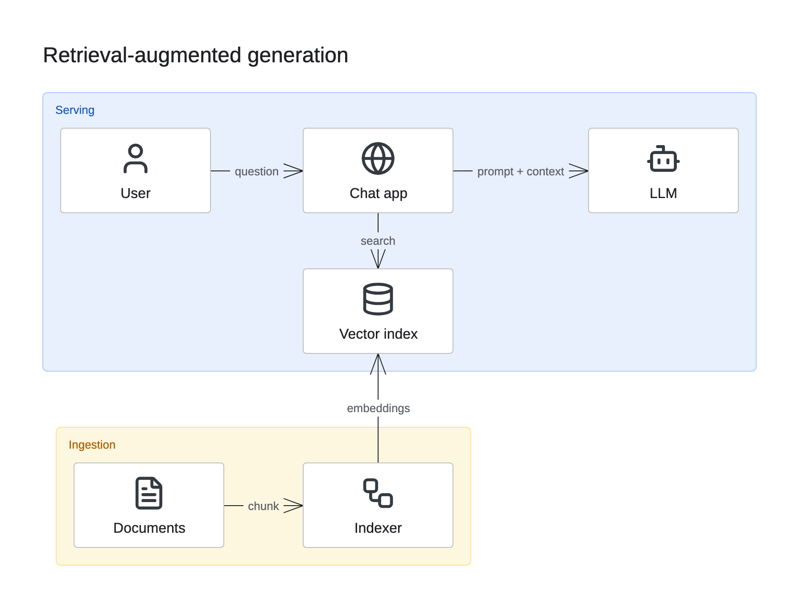
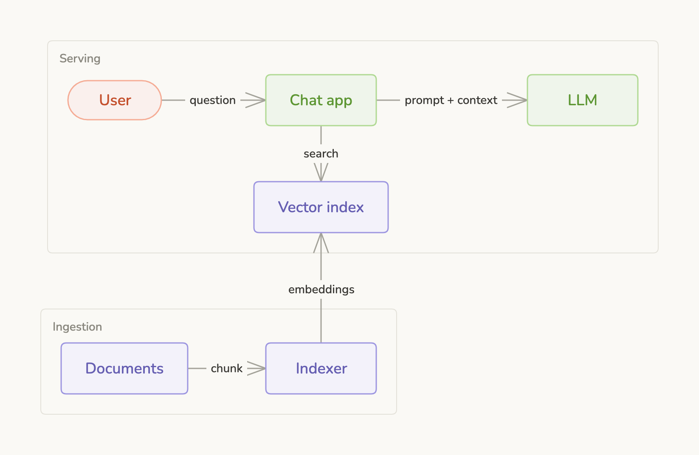
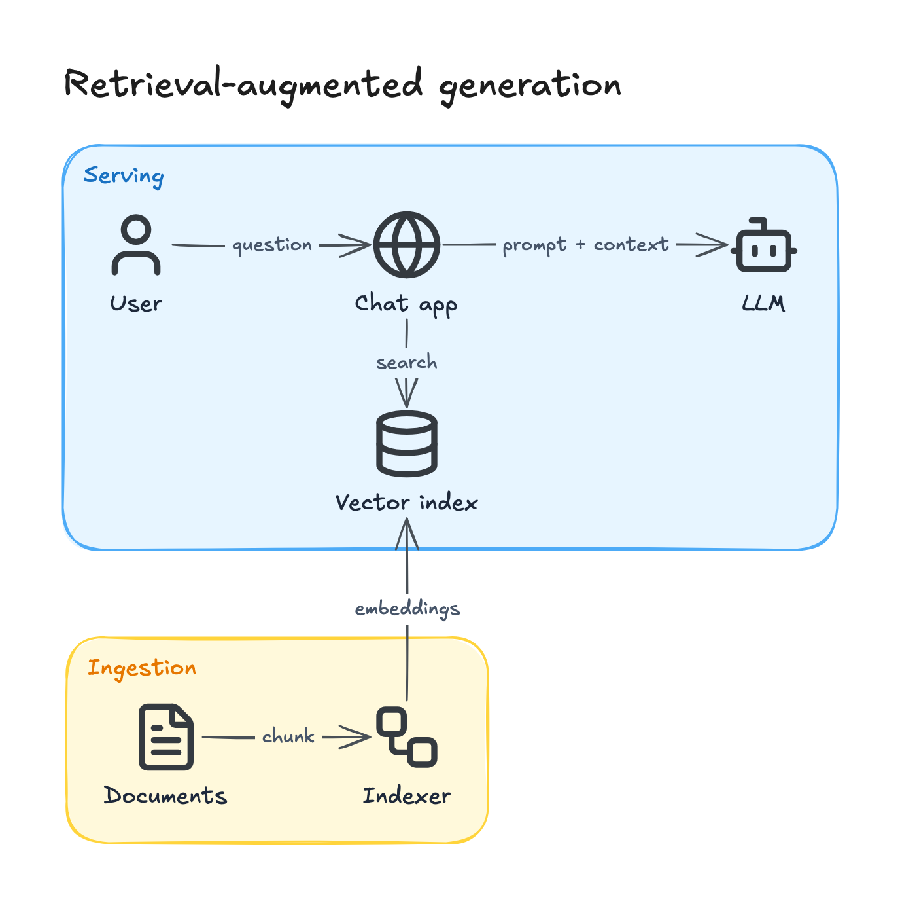
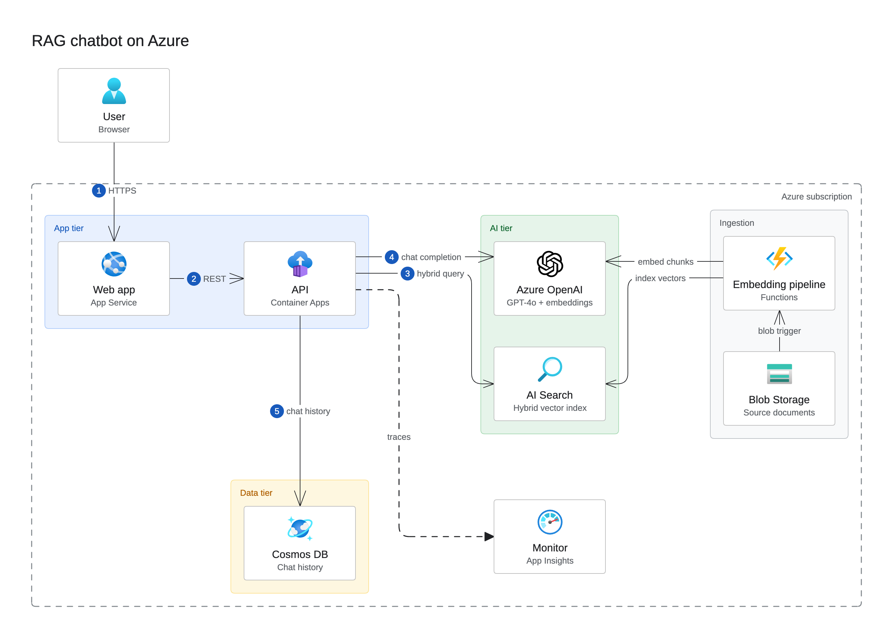

# diagram-toolkit

A GitHub Copilot CLI plugin for publication-quality Excalidraw architecture diagrams. Copilot writes a semantic **spec** (what exists, how it groups and connects). The engine owns everything visual:
- grid layout and straightening
- orthogonal routing
- one of three frozen presets
- official icons
- a headless render
- lint gates
- a vision critic loop

The output is an editable `.excalidraw` file plus PNG and SVG.

| Reference | Concept | Sketch |
|---|---|---|
|  |  |  |



## Install

```bash
copilot plugin install jamesmorrissey11/diagram-toolkit
```

**Requirements:**
- Node.js 22 or newer.
- A local Chrome, Edge, Chromium or Brave. Set `DIAGRAM_CHROME_PATH` to use a specific one.

There is no `npm install`: the runtime has no dependencies, and everything it needs is vendored.

**Check the setup:**

```bash
node ~/.copilot/installed-plugins/*/diagram-toolkit/skills/arch-diagram/engine/cli.mjs doctor
```

**Official cloud icons (optional).** These are recommended for the reference preset. Download the [Azure architecture icons](https://learn.microsoft.com/azure/architecture/icons/), accepting Microsoft's terms, then import them:

```bash
node <engine>/cli.mjs icons import azure ~/Downloads/Azure_Public_Service_Icons_V25.zip
```

Imported packs live in `~/.diagram-toolkit` (override with `DIAGRAM_TOOLKIT_HOME`) and are never committed. Without a pack, the generic icons and the AI/infra logos still work. Draft builds show a visible `?` placeholder for an unknown icon, and `--publish` builds refuse to ship one.

## Use

Ask Copilot for a diagram, for example "Draw the architecture of our RAG service for the docs site." The `arch-diagram` skill runs these steps:
1. Brief.
2. Spec, with `icons search` for each icon.
3. `build`.
4. Fix any gates that fail.
5. Critic review (at most 3 rounds).
6. Delivery of the `.excalidraw`, `.png` and `.svg` files, with an `imgcat` command for the PNG.

To refine, give feedback ("make Cosmos the hero, drop the traces edge"). Copilot edits the spec and rebuilds.

## Presets

| Preset | Use for |
|---|---|
| `reference` | Formal reference architectures: white cards with official icons, tinted tiers and numbered request steps, in the style of the Azure and Google Architecture Centers. |
| `concept` | Simple concept or pattern diagrams of 9 nodes or fewer: role-coloured pastel shapes, pills for inputs and outputs, no icons. In the style of Anthropic's "Building effective agents". |
| `sketch` | An informal whiteboard look: hand-drawn Excalifont, icon-only nodes and pale solid zones. |

Copilot chooses the preset by diagram type. Three things override that, in this order:
1. Your explicit request.
2. The preset already stored in the spec.
3. The default for the diagram type.

The preset is saved into the spec, so a refinement never changes the look.

## Quality gates

Every build is linted on the emitted scene.

**Hard defects** (any one fails the build):
- missing or dropped nodes or edges;
- text overlaps, or text sitting on a node;
- edges passing through nodes;
- detached arrows;
- colours, fonts or sizes that don't come from the preset;
- an unresolved icon in a `--publish` build.

**Readability:** text must render at 11px or more at the `displayWidth` the image will be shown at, and the aspect ratio must stay within the preset's limit.

**Advisory** (reported, but doesn't fail the build): crossings, detours, labels sitting on lines, the largest empty area, and edge length relative to node size.

## Refinement contract

- The spec is the source of truth, and it is embedded in the `.excalidraw` file. `cli.mjs spec <file>` recovers it.
- IDs are stable, so unchanged parts of the diagram stay where they are.
- If you edit a generated file by hand in Excalidraw, the next build refuses to overwrite it (exit code 3). Copilot then asks whether to `--force` the overwrite or to write a new file with `--out`.
- Preserving positions from your hand edits is not supported yet.

## Engine CLI

```
node skills/arch-diagram/engine/cli.mjs help
```

The engine exposes `build`, `render`, `lint`, `spec`, `presets`, `icons search|list|import` and `doctor`. Exit codes:

| Code | Meaning |
|---|---|
| 0 | ok |
| 1 | lint failed |
| 2 | invalid input |
| 3 | hand edits detected |
| 4 | environment problem |
| 5 | internal error |

## Development

```bash
npm install            # dev dependencies only: to rebuild the vendored assets
npm run build:vendor   # router (OpenDiagram @ 6cf306a, Apache-2.0) + Excalidraw 0.18.1 render bundle + fonts
npm test               # unit + end-to-end acceptance fixtures + layout snapshots (uses local Chrome)
npm run check:editor -- <file.excalidraw>...   # open+save in the real Excalidraw 0.18.1 editor; must stay "clean"
scripts/critic-smoke.sh                         # installed diagram-critic agent must see and report planted defects
```

Layout snapshots live in `test/snapshots/`; refresh them only for intended layout changes with `UPDATE_SNAPSHOTS=1 npm test`.

Exact scene goldens live in `test/goldens/` and cover every deterministic byte of each fixture's `.excalidraw` output. A missing golden fails the run; write goldens only for intended output changes with `UPDATE_GOLDENS=1 npm test`.

See [NOTICE](NOTICE) for third-party licences.
